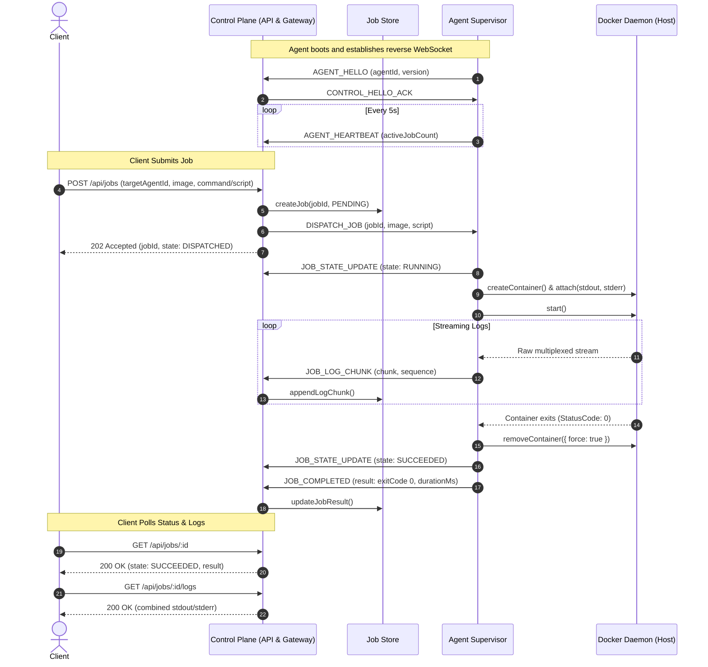

# Distributed Job Runner (DJR)

[](https://www.typescriptlang.org/)
[](https://www.docker.com/)
[](LICENSE)

A resilient, production-grade distributed job execution platform running containerized tasks across remote agents.

Designed to address distributed communication, out-of-order state transitions, failure recovery, live streaming, artifact persistence, and multi-tenant agent routing behind NATs and firewalls.

---

## 📖 Table of Contents
1. [Architecture & Sequence Diagram](#-architecture--sequence-diagram)
2. [Interactive Swagger API Reference](#-interactive-swagger-api-reference)
3. [Component & Method Breakdown](#-component--method-breakdown)
   - [Agent: `DockerRunner`](#agent-dockerrunner)
   - [Agent: `AgentSupervisor`](#agent-agentsupervisor)
   - [Control Plane: `AgentGateway`](#control-plane-agentgateway)
   - [Control Plane: `MemoryJobStore`](#control-plane-memoryjobstore)
   - [Control Plane: `createJobRouter`](#control-plane-createjobrouter)
4. [Architecture Decision Records (ADRs)](#-architecture-decision-records-adrs)
5. [Roadmap & Branching Strategy](#-roadmap--branching-strategy)
6. [Quick Start & Verification](#-quick-start--verification)

---

## 🏗 Architecture & Sequence Diagram

```
                     Client (User / CLI)
                              │
               POST /api/jobs │ (Targeted by agentId)
                              ▼
                  ┌───────────────────────┐
                  │     Control Plane     │
                  │  (REST API + Gateway  │
                  │   + OfflineJobQueue)  │
                  └───────┬───────┬───────┘
                          │       │
            agent-alpha   │       │ agent-beta
            WebSocket     │       │ WebSocket
                          ▼       ▼
                  ┌───────────┐┌───────────┐
                  │   Agent   ││   Agent   │
                  │   Alpha   ││   Beta    │
                  └─────┬─────┘└─────┬─────┘
                        │            │
            /var/run/   │            │ /var/run/
            docker.sock │            │ docker.sock
                        ▼            ▼
                  ┌───────────┐┌───────────┐
                  │ Container ││ Container │
                  │  Worker   ││  Worker   │
                  └───────────┘└───────────┘
```

### End-to-End Execution Flow (Mermaid Diagram)



---

## 📑 Interactive Swagger API Reference

Once the Control Plane is running, interactive OpenAPI/Swagger UI is accessible at:
👉 **[http://localhost:4000/api/docs](http://localhost:4000/api/docs)**

| Endpoint | Method | Description |
| :--- | :--- | :--- |
| `/api/jobs` | `POST` | Asynchronously submit a job (returns `202 Accepted` with `jobId`). Idempotent when `idempotencyKey` is provided. |
| `/api/jobs/:id` | `GET` | Retrieve job lifecycle state (`PENDING`, `DISPATCHED`, `RUNNING`, `SUCCEEDED`, `FAILED`, `TIMED_OUT`) and result metrics. |
| `/api/jobs/:id/logs` | `GET` | Retrieve aggregated stdout/stderr logs and raw sequenced chunks. |
| `/api/jobs` | `GET` | List all tracked jobs. |
| `/api/agents` | `GET` | List all connected agents, their Docker engine versions, and heartbeat liveness. |

---

## 🔍 Component & Method Breakdown

### Agent: `DockerRunner`
*Location: [`apps/agent/src/docker/runner.ts`](file:///d:/part/internship/task1/apps/agent/src/docker/runner.ts)*

Responsible for interacting directly with the host's Docker daemon via `dockerode`:
* **`verifyDockerConnection()`**:
  * *What it does*: Pings the Docker daemon.
  * *How it does it*: Invokes `docker.version()`, extracts version strings, and logs a structured heartbeat. Throws if the daemon is unreachable.
* **`ensureImageExists(imageName)`**:
  * *What it does*: Ensures the required image is present locally before attempting container creation.
  * *How it does it*: Calls `docker.getImage().inspect()`. If not found, calls `docker.pull()` and monitors pull progress via `followProgress()`.
* **`runJobContainer(options)`**:
  * *What it does*: Spawns an isolated sibling container, captures live output, enforces timeout limits, and cleans up.
  * *How it does it*:
    1. Creates container with label markers (`djr.job-id`, `djr.agent-id`) and safety RAM cap (512MB).
    2. Attaches to raw stream before starting; pipes stream into `demuxStream` which splits multiplexed bytes into separate `stdout` and `stderr` streams.
    3. Starts container and races `container.wait()` against a watchdog timer (`timeoutMs`).
    4. If the timer fires first, calls `container.stop({ t: 2 })` and sets exit code `124`.
    5. Cleans up container resources (`container.remove({ force: true })`).
* **`listOrphanedContainers(agentId)`**:
  * *What it does*: Queries Docker for any leftover containers with matching labels (used for crash recovery and reconciliation).

---

### Agent: `AgentSupervisor`
*Location: [`apps/agent/src/supervisor/agent.ts`](file:///d:/part/internship/task1/apps/agent/src/supervisor/agent.ts)*

Manages outbound network connectivity and coordinates job execution:
* **`start()`**: Boots the agent, validates Docker connectivity, and calls `connect()`.
* **`connect()`**:
  * *What it does*: Initiates outbound WebSocket connection to `ws://control-plane:4000/ws/agent`.
  * *How it does it*: Binds lifecycle events (`open`, `message`, `close`, `error`). Automatically schedules a 3-second reconnect backoff upon disconnection.
* **`sendHello()`**: Transmits initial handshake (`AGENT_HELLO`) containing agent ID and version.
* **`startHeartbeat()` / `stopHeartbeat()`**: Sends periodic `AGENT_HEARTBEAT` messages reporting active container counts.
* **`handleServerMessage(msg)`**: Parses incoming messages (`CONTROL_HELLO_ACK`, `DISPATCH_JOB`, `CANCEL_JOB`).
* **`executeJob(req)`**:
  * Broadcasts initial `JOB_STATE_UPDATE` (`RUNNING`).
  * Runs container via `dockerRunner.runJobContainer()`.
  * Relays streaming chunks via `JOB_LOG_CHUNK` with monotonically increasing sequence IDs.
  * Emits final state (`SUCCEEDED`, `FAILED`, or `TIMED_OUT`) and `JOB_COMPLETED` summary.

---

### Control Plane: `AgentGateway`
*Location: [`apps/control-plane/src/ws/gateway.ts`](file:///d:/part/internship/task1/apps/control-plane/src/ws/gateway.ts)*

The WebSocket gateway terminating incoming reverse agent connections:
* **`init()`**: Sets up WebSocket connection handlers, extracts messages, and handles agent unregistrations on disconnect.
* **`handleAgentMessage(ws, msg)`**: Dispatches agent registration, heartbeats, state updates, and log chunk ingestion into the store.
* **`dispatchJob(req)`**:
  * *What it does*: Routes a job to the specific target agent's active WebSocket connection.
  * *How it does it*: Looks up the socket by `targetAgentId`. If online, serializes `DISPATCH_JOB` and marks state as `DISPATCHED`. Returns `false` if agent is offline.
* **`isAgentConnected(agentId)`**: Returns boolean liveness of an agent.

---

### Control Plane: `MemoryJobStore`
*Location: [`apps/control-plane/src/store/memory.ts`](file:///d:/part/internship/task1/apps/control-plane/src/store/memory.ts)*

In-memory data store (designed for pluggable persistence):
* **`createJob(req)`**: Initializes job in `PENDING` state and indexes `idempotencyKey`.
* **`findJobByIdempotencyKey(key)`**: Retrieves existing job record to prevent duplicate submissions.
* **`updateJobState(jobId, state)`**: Updates lifecycle status and `updatedAt` timestamp.
* **`appendLogChunk(logChunk)`**: Ingests sequenced log chunks.
* **`updateJobResult(jobId, result)`**: Persists exitCode, duration, and error metrics.
* **`registerAgent(agent)` / `updateAgentHeartbeat(agentId, count)`**: Tracks connected agent pool.

---

## 🏛 Architecture Decision Records (ADRs)

Formal design documentation stored in [`docs/adr/`](file:///d:/part/internship/task1/docs/adr/):
* **[ADR 0001: Reverse Connection Architecture](file:///d:/part/internship/task1/docs/adr/0001-reverse-connection-architecture.md)** — Explains why outbound WebSockets are used to penetrate firewalls and NATs.
* **[ADR 0002: Docker Socket Mounting (DooD)](file:///d:/part/internship/task1/docs/adr/0002-docker-socket-mounting.md)** — Explains why `/var/run/docker.sock` is mounted rather than running nested DinD.

---

## 🚀 Roadmap & Branching Strategy

| Stage | Branch | Focus |
| :--- | :--- | :--- |
| **Stage 1 (MVP)** | `stage-1-mvp` | **Completed**: End-to-end containerized execution, reverse WebSocket gateway, REST API, Swagger UI, isolated sibling containers. |
| **Stage 2** | `stage-2-multi-agent-routing` | Multi-agent pool (`agent-alpha`, `agent-beta`), targeted routing, offline queueing. |
| **Stage 3** | `stage-3-logs` | Live SSE/WS log streaming, durable artifact persistence, backpressure buffer. |
| **Stage 4** | `stage-4-reliability` | Crash recovery, network drops mid-job, reconciliation of orphaned containers, idempotent state transitions. |
| **Stage 5** | `stage-5-observability-demo` | Structured logging, trace IDs, automated demo scripts. |

---

## 🏃 Quick Start & Verification

### 1. Start Services
```bash
docker compose up -d
```

### 2. Check Interactive Documentation
Open your browser at **`http://localhost:4000/api/docs`**

### 3. Submit a Test Job
```powershell
$job = Invoke-RestMethod -Uri "http://localhost:4000/api/jobs" -Method Post -ContentType "application/json" -Body '{
  "targetAgentId": "agent-mvp-01",
  "image": "alpine:latest",
  "script": "echo Hello from DJR!; uname -a; date;"
}'
$job
```

### 4. Fetch Results & Logs
```powershell
Invoke-RestMethod "http://localhost:4000/api/jobs/$($job.jobId)"
(Invoke-RestMethod "http://localhost:4000/api/jobs/$($job.jobId)/logs").logs
```
